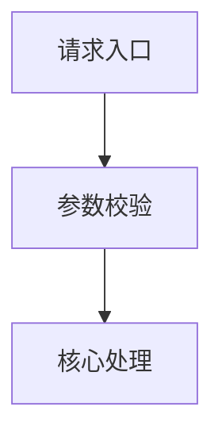

# RFC 设计文档

为一个开发需求产出一份可评审的设计文档，并按 RFC 方式编号落盘。只写文档，不实施代码改动。

## 工作流程

1. 需求理解：用 3～6 行复述需求、目标和关键约束，显式列出关键假设与待确认事项；仅当歧义会实质改变设计方向时才提问，其余标注假设后继续。
2. 只读核对现状：同时检索仓库内相关文档（如 README、设计文档、接口说明、任务记录）和实际代码。文档中写到的接口、数据表、模块、文件路径必须经过真实代码核对；未核对的内容一律标注“待确认”，不得虚构。文档与代码不一致时以代码为准，并按「文档与代码冲突处理」核实来源、区分类型后记录到设计文档。
3. 复用与设计判断：先检索已有接口、数据模型、工具函数和模块，优先复用或最小化扩展；确需新增时，在对应章节说明现有实现不可复用的原因。选择满足当前需求的最简单直接方案，并检查命名、职责、结构与数据设计是否整洁一致。
4. 确定编号与路径：
   - 目录：用户指定则从之；否则默认当前仓库 `docs/design/`，不存在则创建。
   - 编号：扫描目录内已有 `NNNN-*.md` 文件，取最大编号加 1，四位零填充；目录为空从 `0001` 开始。
   - 命名：`NNNN-短标题.md`，短标题用简短中文或 kebab-case 英文。
5. 按下方固定模板写入文件，八节顺序不得调整。
6. 回读校验：读回文件确认八节齐全、mermaid 代码块闭合，向用户报告落盘路径；存在文档与代码冲突时，在对话中逐条提醒冲突位置、具体差异、来源提交与类型。

## 文档与代码冲突处理

- 发现文档与代码不一致时，用 `git log`、`git blame` 定位改动该段代码或该段文档的提交，再用 `git show <sha>` 核对提交 diff，确认该提交确实引入了这处差异；只使用只读 Git 查询，不改动工作区或分支。
- 依据提交时序与文档性质区分类型：文档本身是设计文档、任务记录或计划，描述的是尚未实现的目标状态，属于“待实施设计”，不算文档错误；文档写成时与代码一致、之后代码提交改变了行为而文档未同步更新，才是“文档过期”。两者都对不上或时序无法确定时，标注“类型待确认”。
- 每条冲突写明：冲突位置（文档路径与章节、代码路径与符号或行号）、具体差异（文档说法与代码现状）、来源提交（SHA、作者、日期、提交摘要及该提交对这处代码或文档的改动）、类型。
- 查不到来源提交（如历史被压扁、文件被移动重命名、初始提交即已不一致、仓库不可访问）时，写“来源提交未查到”并说明原因，不推测 SHA、作者或改动。
- 冲突记录写入设计文档「1. 需求理解」末尾的「文档与代码差异」小节，并在对话中同步提醒；无冲突时不写该小节，也不提醒。

## 设计与开发原则

设计文档必须明确约束后续开发始终遵守以下原则：

1. **优先复用**：动手前先检索现有代码。已有接口、数据模型、工具函数或模块能够满足需求时，一律复用或做最小化扩展，禁止重复造轮子或另起平行实现；确需新增时，必须说明现有实现不可复用的具体原因。
2. **保持整洁**：接口定义、代码结构、数据库设计和实现代码必须整洁、一致、可读，命名清晰、职责单一，不引入或遗留冗余字段、死代码和临时补丁。
3. **架构清晰、拒绝过度设计**：采用满足当前需求的最简单直接方案，不引入不必要的抽象层、设计模式、预留扩展点，也不为假想的未来需求增加复杂度。
4. **测试克制**：测试只覆盖核心业务逻辑和关键路径，以最少的用例证明行为正确；不堆砌防御性安全检查、异常探测、预警类断言，也不为极端边界情况编写冗余用例。
5. **调研有据**：代码调研必须同时核对仓库内相关文档和实际代码，不凭记忆或假设下结论；文档与代码不一致时以代码为准，并明确指出差异。

## 固定文档模板

````markdown
# 设计文档：<标题>

- 日期：YYYY-MM-DD
- 状态：草稿

## 1. 需求理解

背景、要解决的问题、预期行为变化；关键假设与待确认事项分条列出。

### 文档与代码差异

仅在发现冲突时保留本小节，逐条写明冲突位置、具体差异、来源提交（SHA / 作者 / 日期 / 改动，查不到写“来源提交未查到”及原因）、类型（待实施设计 / 文档过期 / 类型待确认）。

## 2. 接口改动

新增/修改/废弃的接口，逐条写明路径、方法、入参、出参、错误码与兼容性影响；无改动写“无”。

## 3. 数据库改动

表、字段、索引变更与迁移要点，附回滚 DDL；无改动写“无”。

## 4. 流程图



## 5. 范围边界

- 本次做：
- 明确不做：

## 6. 验收标准

- [ ] 可客观验证的条目（checklist 或 Given/When/Then）

## 7. 影响面

受影响的模块、服务、下游调用方，以及性能、安全、兼容性影响。

## 8. 回滚方案

代码回滚方式、数据回滚方式、开关或降级手段、触发回滚的条件。
````

## 写作规则

- 全文简体中文，可夹带必要英文术语。
- 八节缺一不可、顺序固定；某节确无内容时保留标题，写“无”并附一句原因。
- 不把推测写成事实，“无改动”与“待确认”必须显式写出。
- 「文档与代码差异」小节只记录经提交 diff 核实的来源；查不到时写“来源提交未查到”，不推测 SHA、作者或改动。
- 验收标准只写可客观判断的条件，不得写成已经执行或已经通过。
- 涉及测试的验收项只覆盖核心业务逻辑和关键路径，以最少量的用例证明行为正确；仅在需求明确要求或直接影响核心行为时纳入必要的异常、权限、边界与兼容性用例。
- 接口、数据库和实现设计优先写明复用或最小扩展对象；确需新增时写明现有实现不可复用的原因，不设计平行实现、冗余结构或无当前需求依据的扩展点。
- 各节写针对当前需求的实质内容，不保留模板中的说明文字。

## mermaid 语法注意

- 节点 ID 不含空格，用 camelCase 或下划线；不用 `end`、`graph`、`subgraph` 等保留字作 ID。
- 标签含括号、冒号、逗号等特殊字符时用双引号包裹，如 `A["步骤 1: 初始化"]`；边标签同理，如 `A -->|"O(1) 查找"| B`。
- subgraph 用显式 ID 加中括号标签，如 `subgraph auth [认证流程]`。
- 不写自定义颜色或样式，交给渲染主题处理。
